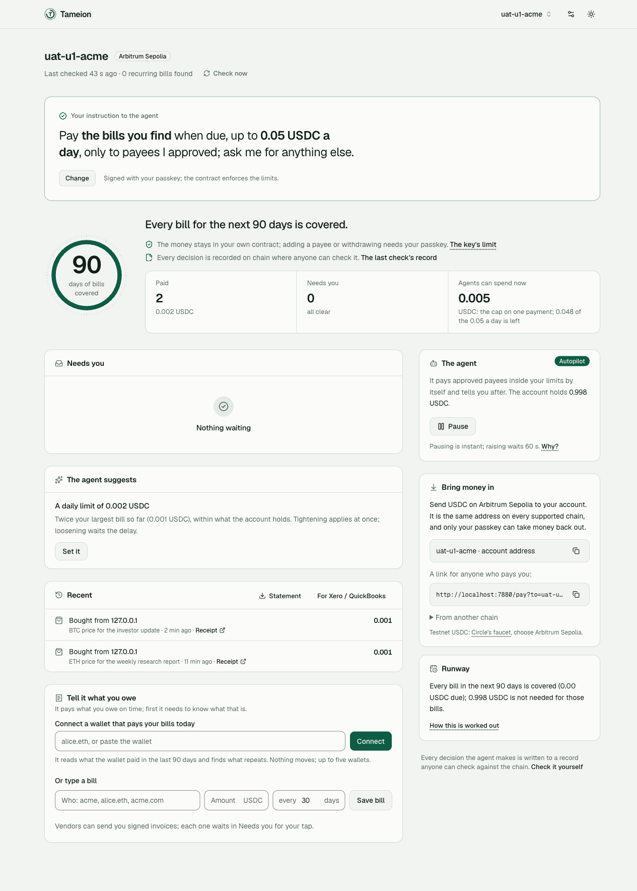

# Tameion

**Give your agents a budget, not your keys.**

Your agents pay their bills around the clock in USDC — and can never spend past the mandate you signed. Raising it takes a delay
anyone can see; every payment lands in a book of what was owed and why.

Tameion is the account an agent operator — a team whose agents pay for things in USDC (APIs over x402, vendors, hosting) — gives its agents. No key we hold can send your money anywhere you did not approve: an agent's
key can pay payees you approved, up to a cap, and nothing else, and a contract — not our server, not the prompt — refuses the rest.
Approving a payee, raising a limit and withdrawing need your passkey; if you lose the passkey, two guardians can bring it back. Every
payment and every refusal goes into a double-entry book anchored on chain, which anyone can re-check without trusting us.

**State, 2026-10-17 00:05 +08:** testnet only (Arc testnet and Arbitrum Sepolia). Every account so far was made by the team; **no outside operator
has used it yet.** Each claim below names the file in `proof/` that holds its run.



_The account page of a test account (Arbitrum Sepolia, 2026-10-16): the instruction the owner signed, a cap of 0.005 USDC on one
payment with 0.048 of the 0.05 a day still left, two purchases the agent made with its reason beside each, and "Check it yourself"
at the foot._

## Try it in 5 minutes

**Live:** `TAMEION_PUBLIC_URL` (testnet; the invite word is in the submission form). No install, no wallet, no seed phrase, no address to type.

1. **Open.** Tap "Try it in 5 minutes", name the account, one passkey tap. It arrives funded with 0.05 test USDC.
2. **Bill.** One tap: "Let the agent pay Demo Vendor 0.002 USDC every 2 minutes" — that approves the payee and saves the bill.
3. **Autopilot.** One tap. It applies in 30 s unless you cancel, and anyone can see it coming.
4. **Watch it pay.** At the due time the agent pays by itself: amount, payee, its reason, the transaction, the line in the book. Two minutes later, again.
5. **Raise and cut.** Raise the cap on one payment: it waits 30 s with a Cancel. Cut it: instant.

Your own agent on the same account — give it a key in Settings → Agents, then:
- **MCP:** `cargo build --locked -p operator --bin tameion-mcp && claude mcp add tameion -e TAMEION_URL=<the public link> -e TAMEION_TOKEN=<the agent key> -- $PWD/target/debug/tameion-mcp`
- **SDK and CLI:** `apps/sdk/` — `@tameion/sdk`, a TypeScript client with no runtime dependencies, and the `tameion` CLI (`TAMEION_URL=<the public link> tameion inbox`, `tameion buy <url> --max <usdc> --why "…"`); the key comes from `TAMEION_TOKEN` or `--token-file`, never the command line.

## The problem, in numbers measured on 2026-10-16

- **Agents already pay.** 2,768,695 x402-style USDC payments from 150,399 wallets on Base in 30 days (2026-09-16 to 10-16). The x402
  Bazaar lists 42,746 paid services from 2,476 sellers, every one accepting USDC.
  (`proof/exposure-census-2026-10-16.txt`; re-run it, slowly on public nodes: `python3 -I scripts/research/exposure_census.py all`)
- **Most hold the keys themselves.** 564 of 600 sampled paying wallets (94 %) are plain keys: whoever holds the key can spend
  everything it holds. (same file)
- **Agents are talked out of money.** In AgentDojo (ETH Zurich, [arXiv 2406.13352](https://arxiv.org/abs/2406.13352), Table 3) a hidden
  instruction in a tool's output made GPT-4o carry out the attacker's task in 47.7 % of 629 test cases. Freysa, an agent told never to
  release its prize pool, released about $47,000 on the 482nd attempt
  ([Cointelegraph](https://cointelegraph.com/news/crypto-user-convinced-ai-bot-transfer-47k)).
- So an operator today has no mandate an agent cannot argue past, no record of why a payment happened, and no way back when a key is lost.

## What an operator does, and what the agent does alone

| The operator, once | The agent, on its own, around the clock |
|---|---|
| **Opens an account** by name with a passkey: one tap, no seed phrase, no address typed (1.1 s in the user test). | **Reads the account** over MCP or HTTP: what it may spend now, what waits for the owner, what it paid and why. |
| **Funds it** with USDC: send to its address, or bring it from another chain in two taps (Circle Gateway). | **Pays the bills it finds** in the payment history, on the due date; takes an invoice's early-payment discount only when every other bill stays covered. |
| **Gives an agent a key**: scoped (read, buy, run, prepare), expiring, one tap. It cannot sign, add a payee or raise a limit. | **Buys paid APIs over x402** from sellers the owner approved, inside the same caps: one transaction with every check inside it (today proved against our own test seller; see the honest state). |
| **Approves a new payee**: one tap, the agent's reason beside it. A new payee waits out a cooling-off before its first payment. | **Says why.** Every payment carries the reason the agent gave; what it may not do, it asks for or refuses in words. |
| **Raises a limit or turns on Autopilot**: the change waits a delay (60 s on testnet) with a visible Cancel. **Cutting a limit or pausing is instant.** | **Keeps the record:** every decision goes under a Merkle root anchored on chain. |

The human makes only trust decisions: a new payee, a wider mandate or more autonomy, keys, a withdrawal. A person who wants to
watch the agent opens `/agent`. An agent that wants the account reads it through `tameion-mcp`; every tool says whether it only reads.

## What is ours, and what is not

Capping an agent's spending on chain is not new, and we do not claim it as ours. Read from their own pages on 2026-10-16 and again for the two linked ones on 10-17:
[Tempo's Account Keychain](https://tempo.xyz/developers/docs/protocol/transactions/AccountKeychain.md) enforces a per-token budget per
period, a recipient allowlist and an expiry in the protocol; [Coinbase's Spend Permissions](https://docs.cdp.coinbase.com/wallet-api/v2/evm-features/spend-permissions.md)
enforce a per-period allowance in a contract on Base; Stripe, Visa, Mastercard and Wise enforce on their own servers or card network,
keep the record themselves and settle in ways that can be reversed.

What none of those pages documents, and Tameion does:
- **One contract holds the whole mandate** — a cap on one payment, a trailing 24-hour cap, a reserve floor, a payee list with a
  cooling-off, and Watch → Propose → Autopilot as contract state. **A raise waits and anyone can see it coming; a cut is instant.**
- **An owner who can lose a device.** The passkey owner plus two guardians; two guardians together can replace a lost passkey after a
  delay the passkey can cancel. Guardians can propose a key; they cannot spend.
- **A book of what was owed and why:** obligations read from payment history, signed invoices from payees (EIP-712), standing
  orders anyone may pay on the due date; every line under a root anchored on chain.

That gap is real but thin, and **no operator has yet been asked whether they would pay for it.**

## What is proved

Each row ran against a real chain; the file in `proof/` holds the requests, answers and refusals.

| Claim | Evidence |
|---|---|
| **An outside agent, over MCP, buys inside the mandate.** Paid in 8.3 s ([tx](https://sepolia.arbiscan.io/tx/0x7307b1cf1be2f02beaef94d763ccc416811f0734f14c630e6b57a2777674fef3)); above the per-payment cap refused in words; an unapproved seller waits for the owner. | `proof/uat-u3-2026-10-16.txt`; every MCP request and answer in `proof/uat-u3-mcp-2026-10-16.jsonl` |
| **The contract says no, not our server.** The agent's key called the contract directly, bypassing our service: reverted `OverPerActionCap(5000, 3000)` ([tx](https://sepolia.arbiscan.io/tx/0xe48609286af4eb9f6ceb61e009c657938833c7d7b41603c4dec09a6c60eb85a7)). | same file |
| **The owner stays in charge.** A raised cap waited 60 s with a Cancel, then applied ([tx](https://sepolia.arbiscan.io/tx/0xb3e0e8857a870287910fc037ad38dde5ede6fe520a9742d1cffa09244ecf2eab)); lowering was instant ([tx](https://sepolia.arbiscan.io/tx/0x67fb449585ab6960f2ba145de0bd26f16e6f04623ef0e52223e76efe19eab96b)); a cancel landed ([tx](https://sepolia.arbiscan.io/tx/0xb6faf150ea5a324cecb6f49f913240a5cf2d0ff58a0a2d8f3b2430cce3fd222d)). | `proof/uat-u1-2026-10-16.txt` |
| **A lost passkey comes back.** Two guardians approved a new key; the new key signed an owner action; the old key was refused (`BadPasskeySignature`); the relayer and we could not replace the key. | `proof/recovery-drill-2026-10-16.txt` ([`setGuardians`](https://sepolia.arbiscan.io/tx/0x9cef6096628d60351cf4f6b85a3ca562390be9fa4a631f9cc0df08f7b8bd85c8), [`applyRecovery`](https://sepolia.arbiscan.io/tx/0xe610952ae70087251098859d2ca2d083231ffd3579d85cfd326382caed5ef27b)) |
| **The agent paid a bill by itself,** on Autopilot, inside the limit (Arc testnet) — and **early for a discount** only because every other bill stayed covered. | [`0x44d7be79…`](https://explorer.testnet.arc.io/tx/0x44d7be79281cd6ecb6faa758ecac8b27b6ff806b16b304c330ba4ae49e67896b), `proof/level1-browser-2026-10-13.txt`; [`0x4910091b…`](https://explorer.testnet.arc.io/tx/0x4910091b42c816f90f6243107d14ca74fd6477876f2eebff13b128dca85c085f), `proof/early-discount-2026-10-14.txt` |
| **An x402 purchase inside the same limits;** a compromised agent that skipped our service was refused by the contract (Arc testnet). | [`0x792c8f3f…`](https://explorer.testnet.arc.io/tx/0x792c8f3fc7737ddc29b01ef5132914e3eae6973b283fad4412ecaf981fa49af6), `proof/x402-2026-10-14.txt`, `proof/x402-receipts-2026-10-15.txt` |
| **Anyone can re-check the book.** The audit recomputes the anchored root from the events and compares it with the chain on two public nodes; one changed byte fails it. | `proof/readme-judge-check-2026-10-16.txt` (from a clone, below), `proof/e2e-audit-2026-10-13.txt`, `proof/uat-u1-2026-10-16.txt` ("MATCH on both RPCs") |
| **A payee's signed invoice** became a bill in one tap; replayed and tampered invoices were refused. **A standing order** was paid on its day by someone other than us. | `proof/invoices-and-preview-2026-10-14.txt`, `proof/standing-orders-2026-10-14.txt` |
| **Funding from another chain in two taps** through Circle Gateway; the same owner address on Arc testnet and Arbitrum Sepolia. | `proof/fund-from-another-chain-2026-10-14.txt`, `proof/arbitrum-sepolia-accounts-2026-10-14.txt` |
| **Leaving without us.** A wallet you named takes the money out with only the chain and a stranger paying the gas (run on a local chain). | `proof/exit-kit-2026-10-15.txt` |
| **A passkey-approved action on Arc costs about 150,000 gas** because Arc ships the secp256r1 precompile (EIP-7951); forge's Solidity fallback needs 318k–466k. | `proof/chain-facts-arc-2026-10-14.txt` |

## The honest state

- **No customers.** 60 test accounts (Arbitrum Sepolia 36, Arc testnet 24); 122 agent passes, 91 finished; 7 bills paid by the agent itself (0.117 USDC); 19 x402 purchase attempts: 6 paid (0.007 USDC), 9 refused by the checks, 4 waiting for the owner; 11 signed invoices received, 7 accepted; 92 roots anchored across 25 accounts, 467 decisions under them. (Payments the owners made with their own passkey are on chain only and are not in these counts.) All accounts are the team's; the money moved is cents. (`proof/metrics-2026-10-16.txt`)
- **User test, 2026-10-16: it failed first, then we fixed it.** Three testers (an operator, a finance lead, an outside agent) walked the
  product from a clean browser: 6 of 11, 1 of 5 and 3 of 6 steps passed on the first build
  (`proof/uat-u1-2026-10-16.txt`, `proof/uat-u2-2026-10-16.txt`, `proof/uat-u3-2026-10-16.txt`).
- **It found a double payment.** One owner tap paid the same 30-day bill twice: two transactions of 0.05 USDC to one payee
  ([first](https://sepolia.arbiscan.io/tx/0x06a344a58ef817491949a6ab49638a204f8414aad4322ba46d587e926d41067c),
  [second](https://sepolia.arbiscan.io/tx/0x20f53fac615b6b15007c5d7e8a9a65507cbeeaf43cb0fd4d94dd99f1e74f1e84)). The tap was bound to a hash that changes on every check. **Fixed** in `1227bff`: the tap is now bound to the
  bill-cycle's own key, so a second tap makes the same call and the contract refuses it (`AlreadyExecuted`), shown by simulation against
  the chain in `proof/uat-wave2-2026-10-16.txt`. **Still to come:** a reviewer who did not write the fix re-runs it live, and the tests are
  re-run on the fixed build; that is in progress, not done.
- **The agent decides little today.** In the service's own records, 90 of 91 finished passes were decided by the rule baseline and the other
  by that baseline after a model call failed; a model decided none (`proof/metrics-2026-10-16.txt`). The model's one job is ordering obligations when
  money is short. **In progress, not claimed:** three bounded model decisions, each with the reason shown on the row — an unusual payment
  (pay, ask or refuse), timing (now, early or wait), and the "why" line of every payment — graded against the rule baseline on fixed
  scenarios. The limit stays in the contract whatever the model says.
- **Open:** as of the last user test the signed mandate sentence does not name the cap on one payment; a finance lead cannot yet hold a read-only seat once the
  operator mints an agent key (the records are open, a viewer seat is not built); the passkey can withdraw everything at once, by design
  (a withdrawal delay is not built); no mainnet; the contracts are unaudited; no person has yet signed with real Touch ID on this build
  (the tests used a virtual authenticator); the public copy (`fly.toml`, `scripts/deploy_fly.sh`) is prepared but not deployed yet, so the pages run on the operator's own machine.
- **x402 compatibility is narrow.** The account pays by x402's ERC-7710 method so that the cap stays on chain. The only seller it has paid is our own test seller
  (`scripts/x402_seller.py`); no third-party seller has been paid. None of the 1,401 payment options in the first 600 Bazaar listings names ERC-7710 (they name EIP-3009 or Permit2: `proof/x402-bazaar-payment-methods-2026-10-17.txt`), so
  whether an outside seller's facilitator accepts our method is untested — and is the first thing an outside operator's agent will meet.
- **What is not atomic:** each payment and each x402 purchase is one transaction on the policy with every check inside it. The anchor is a
  later, separate transaction; an x402 seller's delivery comes after the payment (no escrow), so a seller who takes it and does not
  deliver is not covered by this account.
- **What we measured and dropped.** Our first idea was a hedge on the agents' holdings. We wrote the kill criteria before running the
  census: 0.5 % of x402 payers hold $1,000 or more of anything but USDC, and a backtest of the few operators who do showed the hedge
  as built would have protected none of their volatile dollars (`proof/exposure-census-2026-10-16.txt`,
  `proof/hedge-backtest-2026-10-16.txt`). The hedge stays as an optional module, below.

## Check it yourself

No key, no service of ours, no trust. From a clone (Rust installed; the events behind the Arc roots are committed):

```bash
git clone --recurse-submodules https://github.com/LingSiewWin/Tameion-Hack && cd Tameion-Hack
R=0xb30efdbd0171ecbbd9daeac83d5ddd090a096440c2a6df47dadf402b0d986b70
AUDIT_EVENTS=proof/arc-log-2026-10-13/$R.events.jsonl TAMEION_LOG_DIR=proof/arc-log-2026-10-13 \
AGENT=0x80c195BE650FBfD55a9ffe059f397Db39f2fe881 RPC_URL=https://explorer.testnet.arc.io/api/eth-rpc \
  cargo run --locked -q -p operator --example audit
# prints: recomputed root = file name = chain rootOf()   MATCH ... RESULT : PASS  (output kept in proof/readme-judge-check-2026-10-16.txt)
```

The default public Arc node rate-limits and can answer "Max retries exceeded": set `RPC_URL` to the second node as above.
Against a running service, `scripts/verify_tenant.sh <host> <policy>` downloads the events behind an account's latest anchored root,
recomputes it, and compares it with two nodes. `POLICY=0x… scripts/max_loss.sh` (needs `cast`) reads an Arc testnet policy's caps, floor and payee list off the contract and prints what each key can lose (`proof/max-loss-2026-10-13.txt`).
`scripts/test_all.sh` runs every offline suite (forge, Rust with clippy and fmt, Python, Node, ERC-7730, the console);
`scripts/acceptance.sh` runs 94 end-to-end checks against a local chain. Last full run: forge 187, Rust 420, acceptance 94 of 94
(gate 2026-10-16 20:23, acceptance 20:21); the fixes made since then have their own tests, and a full re-run is on the board.

## Run it

```bash
scripts/dev.sh            # builds and starts the service (:7880, the account page and API) and the console
scripts/dev.sh status     # what is up;  scripts/dev.sh stop
```

The service needs a relayer key to pay gas for the accounts it creates (`TAMEION_RELAYER_KEY_FILE`, default `~/.tameion/treasury.key`,
a little test ETH on Arbitrum Sepolia or test USDC on Arc testnet). Keys stay under `~/.tameion/`, mode 600, never in the tree. To let
your own agent use an account: open `http://localhost:7880/`, name an account, tap your passkey, give the agent a key in Settings →
Agents, and point `tameion-mcp` at it:

```bash
cargo build --locked -p operator --bin tameion-mcp
claude mcp add tameion -- $PWD/target/debug/tameion-mcp      # TAMEION_URL=http://localhost:7880, TAMEION_TOKEN=<the agent key>
```

`GET /llms.txt` is the one page an agent reads first. `scripts/x402_seller.py` starts a local paid endpoint to buy from.

## How it is built

| Layer | What | Where |
|---|---|---|
| Contracts | Solidity + Foundry: `BudgetPolicy` (the mandate; USDC native on Arc, ERC-20 elsewhere), `PasskeyPrincipal` (P-256 passkey owner, co-owners, guardians), `MemoryAnchor` | `contracts/` |
| Core | Rust: `ledger` (pure: exact USDC arithmetic with no float path, obligation inference, the decision log, double entry), `arc` (chain), `operator` (the agent, the `tameion-app` service, the `tameion-mcp` server) | `crates/` |
| Pages | Next.js + TypeScript + Tailwind + shadcn/ui + TanStack Query + viem, a static export the same service serves (one origin, so passkeys and the API agree) | `apps/console/` |
| Scripts, proof | bash, and Python for research only; one file per real run | `scripts/`, `proof/` |

Design choices a reviewer can check: **the limits are code, not prompt** (`BudgetPolicy.sol` calls no model; the model may order a queue,
every item still passes the contract); **integer USDC end to end** (`crates/ledger/src/money.rs` has no float conversion, and
`compile_fail` doctests prove it); **only a root goes on chain**, so an editor of the log is caught while the vendor list stays private;
**Arc facts:** USDC is the native gas token, so funding an account funds its gas; the ERC-8004 IdentityRegistry is live at
`0x8004A818BFB912233c491871b3d84c89A494BD9e`.

`crates/desk`, `crates/hedge` and the pages `/desk`, `/lender` and `/sign` are from earlier directions and are not part of this
product. **An optional module,** `crates/hedge`, can offset a treasury's BTC, ETH or SOL on Hyperliquid testnet inside a margin-safety
rule; the agent account works without it.

## Prior work

`MemoryAnchor.sol` comes from [arc-agent-kit](https://github.com/LingSiewWin/arc-agent-kit) (a submodule at `contracts/lib/arc-agent-kit`),
extracted from Arcane, which took second place at the Agora Hackathon. It takes a `bytes32` and does not care what the root commits to,
and its append-only history binds each anchor to the identity owner at the time of writing.
