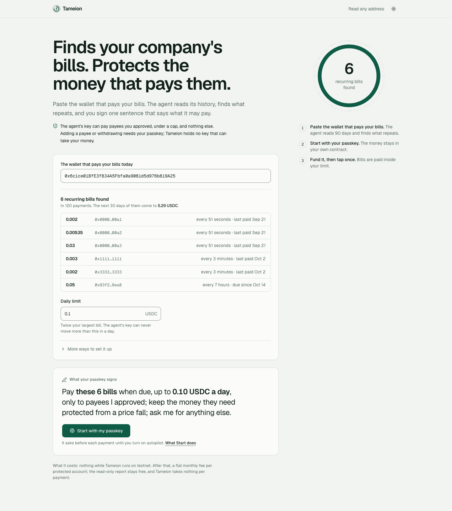
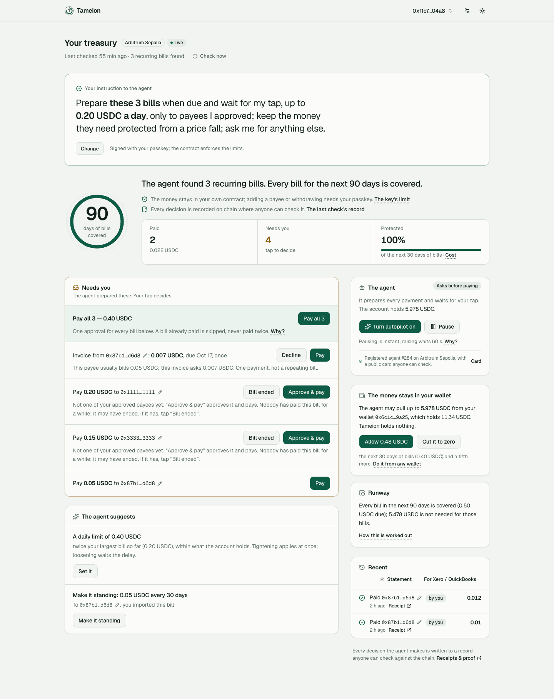

# Tameion

**Tameion Desk: a small gold trader's stock is offset on Hyperliquid while they
hold it, from their own laptop, and their lender gets a statement it can check
without trusting them or us.**

The owner key is made inside the Mac's security chip (Secure Enclave) and
cannot leave it. The exchange key can trade and cannot withdraw. Every step of
a deal is signed by the party who knows it — the supplier its sale, the vault
its receipt, the buyer its purchase — and nothing a counterparty signs is
booked unless the trader approved that counterparty first.

**Who** — a dealer or refiner who holds gold and borrows against it (bank line,
Ar-Rahnu BIZ). **Pain** — the price of everything held is an open bet; a lender
advances less on unhedged stock (A-Mark's credit agreement: 90 % hedged in a
depository, 85 % unhedged, 70 % consigned) and has to take the trader's word for
what is where. Only the commodity majors get hedged borrowing-base reports
today. **What** — a double-entry book in grams of gold that moves with signed
steps (bought → in transit → in stock → in fabrication / consigned → sold), an
offset on Hyperliquid that follows the book by itself, and a statement per deal
— eligible, consigned, not eligible, share offset, printed maximum loss — that
a lender checks against the chain and the exchange. **Not yet** — a single
trader or lender spoken to; mainnet; copper, oil or FX (they exist on
Hyperliquid only as HIP-3 markets, which our safety rule does not allow yet).

## Tameion Desk, proved on testnet (2026-10-15/16)

| What | Proof |
|---|---|
| A 10 g gold deal through its whole life on Hyperliquid testnet: the supplier-signed purchase opened a 0.321 PAXG short (read back), a stranger's forged bill of lading was refused, the lender's statement while in transit printed a maximum loss of 27.35 USDC (427.46 unhedged), the root was anchored on Arbitrum Sepolia, the buyer-signed sale closed the short (read back 0), both books (grams, USDC) balance | `proof/desk-gold-live-2026-10-15-2316.txt` |
| The same through the service's API, on an account whose owner key is in the Mac's Secure Enclave: stock in a vault, 2 g sent to fabrication shown as not eligible, the kit verified | `proof/desk-api-2026-10-15-2330.txt` |
| A signed purchase or sale moves the offset with no tap; a counterparty confirms its own step with its own wallet at `/sign`; posing as another counterparty is refused | `proof/desk-sign-2026-10-15.txt` |
| A lender checks a statement at `/lender` or with `scripts/verify_desk.py`: the statement's hash and signature, every step against the anchored root, every counterparty's own signature, the root in its transaction on two public nodes, the claimed offset against the exchange's own fills; a changed number or step fails | `proof/desk-verify-2026-10-15.txt`, `proof/desk-lender-page-2026-10-15.txt` |
| The owner key made in the Secure Enclave owns the on-chain account and signed a trust action; a software key over the same challenge was refused | `proof/se-owner-2026-10-15.txt` |
| An agent drives the desk over MCP (`desk`, `send_milestone`, `desk_statement`) with a key the chip minted | `proof/desk-mcp-2026-10-15.txt` |
| A code review of all of it found 2 critical and 5 high problems (any bearer string opened a desk; one exchange account served every desk; replayable signatures; lender checks a forged kit could pass); fixed and re-proved: steps are signed for one desk, a lender's check passes only with the statement key, the exchange account and each counterparty pinned | `proof/desk-review-fixes-2026-10-16.txt`, `proof/desk-api-v2-2026-10-16-0028.txt` |
| "Explain it in words": a model on this Mac writes the statement's sentences; code writes every number from the signed statement, and text with a number of the model's own is set aside | `proof/desk-explain-2026-10-16.txt` |
| A second and a third review forged lender files that passed (invented money, duplicated or hidden steps, gold valued on another market, one short claimed by two deals) and found a stolen counterparty key could walk the offset; fixed: the lender's tools recompute every money figure from counterparty-signed steps and check the price against the exchange's own candles (eight forged files fail, the real ones pass), the offset moves by itself only within a running total since the owner last confirmed, past it only the owner's passkey releases a trade | `proof/desk-verifier-money-order-2026-10-16.txt`, `proof/desk-third-review-fixes-2026-10-16.txt`, `proof/desk-limits-2026-10-16.txt` |
| The owner stops a counterparty in one tap (instant; approving it again takes the passkey); each counterparty signs only its role's steps (a vault cannot sign a sale); an agent can stop one over MCP | `proof/desk-stop-party-2026-10-16.txt`, `proof/desk-roles-2026-10-16.txt`, `proof/desk-mcp-stop-2026-10-16.txt` |
| A lender who kept an earlier statement checks that nothing booked before it was removed or changed (RFC 9162 consistency proofs in every statement); the funding paid on the offset is the exchange's own figure (first nonzero hour checked) | `proof/desk-append-only-2026-10-16.txt`, `proof/desk-hold-funding-2026-10-16.txt` |
| The owner's taps on `/desk` sign with the Mac's Secure Enclave through a local bridge (no browser passkey needed) | `proof/desk-se-bridge-2026-10-16.txt` |
| The same desk on **Arc testnet**: the statement's root anchored on Arc, the lender's check passes on two Arc nodes; the desk was connected to its exchange account from the page's API, no restart | `proof/desk-arc-2026-10-16-0303.txt`, `proof/desk-venue-connect-2026-10-16.txt` |
| A deal held across two funding hours: the funding the statement claims is the exchange's own record, to the micro-USDC | `proof/desk-hold-funding-2026-10-16.txt` |
| A statement of the whole stock — every open deal at one moment, one anchor, one file — that the lender checks as one, so a short is never counted twice; the desk issues it by itself each morning | `proof/desk-whole-book-2026-10-16.txt`, `proof/desk-morning-statement-2026-10-16.txt` |
| The pages, read as a dealer and as a credit officer would: the dealer sees what is not protected and what it could cost before signing anything; the lender reads one sentence first and the advance at their own ringgit price and rate | `proof/desk-product-fixes-2026-10-16.txt` |
| A fifth review sold a deal out of a whole-stock file and the file still passed while other stock kept the short open; now the same file fails the moment the short falls below what it counts (live: PASS, a 4 g sale, FAIL 8 s later), a file that mixes moments or repeats a deal is refused, the lender pins the desk itself, and the dealer's headline switches to a live estimate when the offset moved after the last statement | `proof/desk-fifth-review-fixes-2026-10-16.txt` |
| A sixth review deleted a deal from the whole-stock file and re-signed a statement with a smaller short than the exchange held; both now fail (the file must add up to the desk's stated holding; the short a statement read must equal the exchange's own record then) | `proof/desk-sixth-review-fixes-2026-10-16.txt` |
| A counterparty with no crypto wallet signs its step from its phone: `/sign` makes a signing key in the phone's browser and shows the address to send the trader, in English or Chinese, and where the phone allows it sealed so that only its fingerprint or face opens it (only ciphertext in the browser; each signature asks); the signature is the same, so the desk's roles and the lender's check apply unchanged (a consignment booked and checked; a sale outside its role refused) | `proof/desk-sign-phone-key-2026-10-16.txt`, `proof/desk-sign-sealed-key-2026-10-16.txt` |
| A seventh review lowered the desk total in a re-signed file and cut the short for one statement and restored it; both now fail (the account's short must fit inside the desk's stated total; a short bought back since the statement fails it); a step signed twice books once; the signing page shows which desk a signature binds to and where it goes | `proof/desk-seventh-review-fixes-2026-10-16.txt` |
| What the three test desks have done, counted from their own files: 25 deals, 77 steps (67 signed by a counterparty), 135 g bought, 39 offset moves, 23 lender statements over 17 anchors — all team test accounts, no customer | `proof/desk-metrics-2026-10-16.txt` |
| Which goods and currencies can be offset on Hyperliquid today, measured | `proof/hl-markets-2026-10-15.txt` |

Run it: `scripts/prove_desk.sh dry|live` (one deal, end to end) and
`scripts/prove_desk_api.sh <policy> <device-token-file>` (the same through the
service). Code: `crates/desk` (the pure book), `crates/operator/src/desk.rs`
(signed steps, the offset, the statement), `apps/desk-se` (the Secure Enclave
signer), `apps/console/src/app/{desk,sign,lender}`.

---

# The payments account (built 2026-09-27 → 10-15; now the desk's payments part)

**A treasury account for onchain companies — holdings hedged against the
bills, spending capped by a smart contract, every decision provable on-chain.**


The agent's key can pay payees you approved, under a cap, and nothing else.
Adding a payee or withdrawing needs your passkey; raising a cap takes a delay
you can cancel. Tameion holds no key that can take your money.

**Who** — the person who pays an onchain company's bills (contractors, hosting,
auditors, software) in USDC, today one signature at a time from a hot wallet or
a multisig. **Pain** — every payment is manual; one leaked key empties the
wallet; a fall in the company's ETH eats the money the bills need. **What** —
Tameion finds the bills in the wallet's own payment history, pays them on time
inside limits a smart contract enforces, and asks the owner's phone for
anything new. **Proof** — bills shown about 6 s after pasting a wallet; money in
to a checked, anchored account in about 26 s; 39 decision records anchored on
chain; every row in the proof index opens a transaction, and the account page
re-checks any record against two public nodes ("Check it yourself"). **Not yet** — paying
customers (zero), mainnet, an audit.

## In one minute: what a finance lead does, and what happens

| You | What happens (measured on testnet, public RPCs) |
|---|---|
| **Paste the wallet that pays your bills** (or tap "Use the wallet in this browser") | In about 6 seconds the page lists the recurring bills it found in the last 90 days — who, how much, how often — what the next 30 days of them cost, and fills in a daily limit of twice the largest bill. Nothing is created and nothing is signed. |
| **Tap Start** | Your phone's passkey (Face ID, Touch ID, a password manager) becomes the account's only owner. The account's address is reserved; nothing is on chain yet. |
| **Fund it**, or let the agent pull from your wallet under an allowance | One tap sends the exact amount the next 30 days need. About 30 seconds after the money lands, the agent has put the account on chain, read the history, decided what to pay and anchored a record of the decision. |
| **Tap once** | "Pay all" pays every bill waiting, in one approval. When you are ready, turn on Autopilot: from then on the agent pays on its own — only payees you approved, only under the limit. The contract refuses anything else, whatever the agent is told. |

**What the agent does by itself:** reads the wallet's history and infers the
bills; pays them when due, inside the caps; takes an invoice's early-payment
discount when every other bill stays covered; accepts **invoices that vendors —
or vendors' agents — sign and send** (you tap once to approve a new payee);
buys paid APIs (x402) from sellers you approved, inside the same caps; tells
your phone what it paid and what needs you (Web Push); keeps its own gas
topped up; anchors a tamper-evident record of every decision on chain; and,
on Hyperliquid testnet, keeps a short against the company's ETH so a price
fall does not eat the money the bills need.

**What only you do** — the trust decisions, each one passkey tap with the
agent's reason beside it: approve a payee, raise a limit or the autonomy
level, withdraw, change a key. Lowering a limit or pausing is instant;
raising one waits a delay you can cancel.

**Where it runs:** Arc testnet and Arbitrum Sepolia (the same owner address on
both). Read-only reports for Arbitrum One, Base and Ethereum. No mainnet.
Every claim below has a transaction and a file in `proof/`.

### What changed on 2026-10-14/15

- **The first check went from 13 minutes to seconds.** A new client's first
  read of 90 days of history took 788 s and reached only 23 days; it now takes
  about 6 s on Arbitrum Sepolia and 5 s on Arc (wide log windows per chain,
  Arc's explorer index, a history cache, block times read in parallel).
  Receipts were polled every 7 s by default; now every 0.5 s — money in to a
  checked account in about 26 s (median of the accounts made after the fix).
- **The bills are shown before any key or money**, and the limit is proposed
  from them.
- **Signed invoices from vendors and their agents** (EIP-712, signed by the
  address to be paid): verified, compared with history, shown in words; a
  repeating one becomes a bill in one tap, a one-off is paid by your tap and
  can never be paid twice. MCP tools `send_invoice` and `invoices` let other
  agents use it.
- **Web Push** to the installed page, the device approved by your passkey.
- **A security review of the night's code** found and fixed a token-gate bypass
  (a policy string that was not an address), a vendor-chosen action hash, a
  replay that could reopen a decided invoice, an unbounded receipt wait that
  could stall every relayer send, and a relayer that raced its own nonce under
  load (30 of 32 concurrent sends failed before the fix, 32 of 32 landed after).

## Why not Ramp, Mercury, Catena, Circle or a Safe allowance?

Capping an agent's spending is no longer rare — Mercury's agent cards (August
2026), Circle's Agent Wallets (May 2026), Catena Labs (private access) and Safe's
allowance module all let a person set a limit the agent cannot raise. What none
of their own pages shows, and Tameion does:

| | Tameion | Ramp / Mercury / Brex | Catena, Natural | Circle Agent Wallets, Coinbase Payments MCP | Safe allowance, Squads limits |
|---|---|---|---|---|---|
| Finds what the company owes in its own payment history | yes — bills, amounts, cadence, next due | learns GL coding; parses invoices sent to it | not shown | not shown | no |
| Protects the money the bills need from a price fall | yes — a short on Hyperliquid testnet, inside the venue's margin rule | no | not shown | no | no |
| Who holds the money | the owner's contract; the service holds no key that can take it | the bank | the platform (Catena has filed for a trust charter) | the developer's wallet | the owners' multisig |
| Anyone can check every decision | anchored record + `scripts/verify.sh` on two RPCs | internal audit log | "auditability" | not shown | the chain's own history |
| Bank and card rails, licences, customers | **no** — testnet, zero customers | yes | yes / in progress | yes | n/a |

## Where it stands — test accounts made by the team, no customers yet

From the service's own files (`scripts/metrics.py`, output in
`proof/metrics-2026-10-15.txt`):

| | |
|---|---|
| Accounts | 25 (Arc testnet 19, Arbitrum Sepolia 6) |
| Agent checks | 68 (38 finished; 22 of the failures were the service restarting during development) |
| Payments the agent made by itself | 7 (0.117 USDC); bills it brought to the owner instead: 111 |
| Decision records anchored on chain | 39 roots, 293 decisions under them |
| Paid APIs bought (x402) | 3 paid, 5 refused by the checks |
| Invoices signed by vendors | 5 received, 4 accepted |
| First check of a new account (median) | 632 s → 74 s → **26 s** across the 2026-10-14 night fixes |
| Read-only report after pasting a wallet (median) | 9.8 s |

The money moved is pocket change and every account is ours: the machine works
end to end; traction starts with the first company that is not us.

## Stack

| Layer | What it is | Checked by |
|---|---|---|
| Contracts | Solidity + Foundry: `BudgetPolicy` (hold, pull, ERC-20 token, EIP-7702 delegate, ERC-7579 module), `PasskeyPrincipal` (P-256 owner, co-owners, guardians), `MemoryAnchor`; on Arc testnet and Arbitrum Sepolia; ERC-7730 clear-signing descriptors | 187 forge tests, `forge fmt` + lint |
| Agent and service | Rust workspace: `ledger` (pure — money, bill inference, the decision log), `arc` (chain client), `hedge` (Hyperliquid testnet), `desk` (pure: the trade book in grams, stages, the lender's statement), `operator` (the agent, the `tameion-app` HTTP service, the `tameion-mcp` server with 21 tools) | 400 Rust tests, clippy with warnings as errors, anvil acceptance 94/94 |
| For other agents | MCP (21 tools), `/llms.txt`, OpenAPI, x402 purchases, EIP-712 signed invoices | `crates/operator/tests/mcp_stdio.rs`, live calls in `proof/` |
| Notifications | Web Push (RFC 8291/8292), webhooks signed with HMAC | RFC 8291 test vector byte for byte |
| The page customers use | A console in **Next.js 16 + React 19 + TypeScript + Tailwind 4 + shadcn/ui** with motion, TanStack Query and viem — a static export the same service serves, so passkeys and the API share one origin. **Live since 2026-10-15**: Start, the account, `/watch` and settings; the first page stays at `/classic`. Lighthouse (mobile): accessibility 100, best practices 100, performance 89 | `proof/lighthouse-2026-10-15.txt`, `proof/design-after-*.png` |



_Start (2026-10-15): paste the wallet that pays your bills; the agent reads its history and shows what repeats, before
any key exists; the passkey signs one sentence that says what the agent may pay._



_The account (Arbitrum Sepolia, test account): the instruction the owner signed, how many days of bills are covered,
the bills that need a tap with the agent's reason beside each, and the receipts. Every owner action on this page was
run on chain from the console — e.g. Pay all (`proof/console-payall-paid.png`) and sending the surplus back
(`proof/console-send-back.png`)._

## Proof index — every claim, its transaction (Arc testnet unless marked)

Each row ran end to end against a real chain; the link opens the transaction, the file holds the
full run (requests, replies, refusals). Off chain (2026-10-16 06:51): forge 187 tests, Rust 400, console 35, lender verifier 4, anvil acceptance
94/94 (`scripts/test_all.sh`, `scripts/acceptance.sh`). The hedge's Hyperliquid testnet order, read-back
and refused withdrawal are in `proof/hedge-testnet-live-open-2026-10-13.txt`,
`proof/hedge-testnet-live-flatten-2026-10-13.txt` and `proof/hedge-testnet-nowithdraw-2026-10-13.txt`.

| What happened | Transaction | Full run |
|---|---|---|
| The agent paid a bill by itself, inside the limit (Autopilot) | [`0x44d7be79…`](https://explorer.testnet.arc.io/tx/0x44d7be79281cd6ecb6faa758ecac8b27b6ff806b16b304c330ba4ae49e67896b) | [`level1-browser-2026-10-13.txt`](proof/level1-browser-2026-10-13.txt) |
| The owner reviewed six waiting bills and paid them with one passkey tap | [`0xa70fb45e…`](https://explorer.testnet.arc.io/tx/0xa70fb45e49480be718377552368bfd26dd6f17475da6096e7f125768f34ed90e) | [`reviewed-run-2026-10-14.txt`](proof/reviewed-run-2026-10-14.txt) |
| The agent paid a bill early because its invoice gave 2% off — only because every other bill stayed covered | [`0x4910091b…`](https://explorer.testnet.arc.io/tx/0x4910091b42c816f90f6243107d14ca74fd6477876f2eebff13b128dca85c085f) | [`early-discount-2026-10-14.txt`](proof/early-discount-2026-10-14.txt) |
| The agent bought a paid API (x402) from the account, inside the same limits; a compromised agent that skipped our service was refused by the contract | [`0x792c8f3f…`](https://explorer.testnet.arc.io/tx/0x792c8f3fc7737ddc29b01ef5132914e3eae6973b283fad4412ecaf981fa49af6) | [`x402-2026-10-14.txt`](proof/x402-2026-10-14.txt) |
| Every payment, purchase and refusal is under a root anchored on chain; the audit recomputes it on two RPCs | [`0x3739eefd…`](https://explorer.testnet.arc.io/tx/0x3739eefdbfdba784d00db499c40ba37ad729ccedc7d5ca2ce0f006234bcdc96e) | [`x402-2026-10-14.txt`](proof/x402-2026-10-14.txt) |
| On Arbitrum Sepolia too: the same owner address as on Arc, and the agent paid a bill in ERC-20 USDC there | [`0xe276d41c…`](https://sepolia.arbiscan.io/tx/0xe276d41cc1f2c9631c37f26fc6cc3da0fecb58fc042d379b939405e0af22e646) | [`arbitrum-sepolia-accounts-2026-10-14.txt`](proof/arbitrum-sepolia-accounts-2026-10-14.txt) |
| The first check read 90 days of a bill wallet's history in 15 s (before the fix: 788 s, and only 23 days) and anchored its record (Arbitrum Sepolia) | [`0xb554c05d…`](https://sepolia.arbiscan.io/tx/0xb554c05ded652ecc3e77d7e3a643127e9d6352189b60f2604e0954404ae62101) | [`first-check-speed-2026-10-14.txt`](proof/first-check-speed-2026-10-14.txt) |
| The account page shows the bills it found before any money moves; money in → account created, checked and anchored in ~30 s (Arbitrum Sepolia) | [`0x87e5afc7…`](https://sepolia.arbiscan.io/tx/0x87e5afc7cb992df31675a86f6aea564d6449646fae47317475ef9ceb656db61d) | [`invoices-and-preview-2026-10-14.txt`](proof/invoices-and-preview-2026-10-14.txt) |
| A vendor's signed invoice became a bill in one tap; a one-off invoice paid once by the owner's tap; replayed and tampered invoices refused (Arbitrum Sepolia) | [`0x8937f3c0…`](https://sepolia.arbiscan.io/tx/0x8937f3c056badce6aa7dceeb71149990060820b60f5071aef4549ffbd3166607) | [`invoices-and-preview-2026-10-14.txt`](proof/invoices-and-preview-2026-10-14.txt) |
| Start sends nothing; the first check created the account at the address reserved for it | [`0xa7e91631…`](https://explorer.testnet.arc.io/tx/0xa7e916314d2b9e1214a3f43aca979371789d0923e1b04c2c5ca2db9329e3db74) | [`lazy-deploy-2026-10-14.txt`](proof/lazy-deploy-2026-10-14.txt) |
| USDC on another chain came in with two taps through Circle Gateway | [`0x5d89ac50…`](https://explorer.testnet.arc.io/tx/0x5d89ac50661ca410530892590387b5e56d6cd21f770892868c4ba901422337eb) | [`fund-from-another-chain-2026-10-14.txt`](proof/fund-from-another-chain-2026-10-14.txt) |
| The money stayed in the company's wallet; the agent pulled one bill inside its allowance | [`0xfac272df…`](https://explorer.testnet.arc.io/tx/0xfac272df84cec92cec1e852bd41c5dcc799942f3bf8c4fc8c6645a2b0b179526) | [`pull-mode-2026-10-14.txt`](proof/pull-mode-2026-10-14.txt) |
| A standing order was paid on its day by someone other than Tameion | [`0x9ac1276f…`](https://explorer.testnet.arc.io/tx/0x9ac1276ff5675a5b55ca3a2ed6945901cb59fa0c242b6a5c126b8516631fd476) | [`standing-orders-2026-10-14.txt`](proof/standing-orders-2026-10-14.txt) |
| An account with no agent key at all: the owner's one tap paid what waited | [`0xb03ce4ab…`](https://explorer.testnet.arc.io/tx/0xb03ce4ab0e09cbcd06c66aab1080df2bdbd5e212ce44aa11b34a08cd84630d98) | [`keyless-2026-10-14.txt`](proof/keyless-2026-10-14.txt) |
| The company's own wallet became the account (EIP-7702) and the agent paid from it | [`0x0254ff98…`](https://explorer.testnet.arc.io/tx/0x0254ff98cd1094d6709eed6ca47c781442a3af012282fcd4c772114af79fa54f) | [`wallet-7702-2026-10-14.txt`](proof/wallet-7702-2026-10-14.txt) |
| The limits installed as an ERC-7579 module on a smart account; over the cap refused, inside paid | [`0x32f36afd…`](https://explorer.testnet.arc.io/tx/0x32f36afd92e4211be71abe79003deb52f75be6ec4d3af301f2d702f6df932bf9) | [`module-7579-2026-10-14.txt`](proof/module-7579-2026-10-14.txt) |
| Two owners, two approvals: one passkey alone was refused, both together executed | [`0x913b9e67…`](https://explorer.testnet.arc.io/tx/0x913b9e67cf62288d9d5d14b282e085fac32e4ef1b91adffdf5d78109ebe23c73) | [`co-owners-2026-10-14.txt`](proof/co-owners-2026-10-14.txt) |
| A lost passkey replaced by two guardians after the delay; same account, same address | [`0x59dcbaa8…`](https://explorer.testnet.arc.io/tx/0x59dcbaa8bcbd7282b14c6eb6d0c53c55ce9c3207d52b67609ab9977c540be1f4) | [`guardian-recovery-2026-10-14.txt`](proof/guardian-recovery-2026-10-14.txt) |
| The agent's authority lapsed and only the owner's passkey renewed it | [`0x52803a51…`](https://explorer.testnet.arc.io/tx/0x52803a515152fa47153dd79727d75d3f9beb84f87119ddc2fdea646a86859e2b) | [`agent-expiry-2026-10-14.txt`](proof/agent-expiry-2026-10-14.txt) |

What can go wrong, including what is not fixed: the contract is unaudited,
inference can be wrong in ways nothing catches (a wrong bill is still only a
proposal to an approved payee under the cap), and the owner's own key can
empty the account with no delay — it is the owner's money.

## Try it: Level 0, no key (Tameion Watch)

Paste a treasury address, pick a chain, and read what it owes, what the agent
would pay or ask about, and the most a stolen key could lose under caps you
choose. Read-only by type; nothing is sent or stored beyond the report.

```
PORT=7880 cargo run --locked -p operator --bin tameion-app      # then open http://localhost:7880
# /        the account: Paid · Needs you · Protected · Runway · Elsewhere; Start = key + policy + first pass, by default in pull mode (the money stays in your wallet, you approve a limit); one tap funds it from Circle Gateway or sets where the agent reports
# /watch   the read-only report for any address; "Elsewhere" = its USDC in Circle Gateway on other chains
# /level1  receipts, proof and settings
# /level1 (passkeys) needs http://localhost:7880/level1 and a relayer key on the host:
# TAMEION_RELAYER_KEY_FILE=~/.tameion/relayer.key (a key with a little Arc testnet USDC for gas)
```

The front door is the account page: the wallet that pays your
bills and a daily limit, "Start", and the agent runs — Paid · Needs you ·
Protected, one tap where a decision is yours, receipts one link away. Watch
is the read-only report behind it. Chains: Arc testnet, Arbitrum One, Base, Ethereum (USDC). Keyed RPCs via
`TAMEION_RPC_ARBITRUM` / `TAMEION_RPC_BASE` / `TAMEION_RPC_ETHEREUM` make
mainnet scans fast; Base and Ethereum refuse log scans without one and the
service says so at once. Deploy with the `Dockerfile` and `fly.toml`
This is the first rung of the trust ladder. **Level 1** is the
next page (`/level1`): create a passkey in the browser, the service deploys
your policy in Propose mode, one tap approves payees, and every payment the
agent prepares waits for your phone (proved end to end on Arc
testnet; the page describes every call with its own decoder and recomputes
the challenge before the passkey prompt, and refuses anything it cannot
describe; `scripts/verify_tenant.sh <host> <policy>` recomputes any pass's
anchored root from the downloaded events on your own machine). **Level 2** is Autopilot inside the caps: asking for it is
scheduled behind the delay and shown with its ETA, your passkey cancels it
while it waits, pausing is instant (step 5 of the same page;
`TAMEION_LEVEL1_EVERY_SECS` runs each tenant on a schedule).

### For your other agents

`tameion-mcp` is a Model Context Protocol server over stdio:
your Claude Code, OpenClaw or Hermes plugs it in and asks what the treasury
owes, runs a pass, imports bills, or prepares an approval for the owner's
passkey. It holds no key and cannot add a payee, raise a cap or withdraw —
the contract holds those lines for every caller; one tool, `buy_service`,
asks the service to pay a seller the owner already approved, inside the caps. `.claude/skills/tameion/`
teaches a Claude Code session how to use it. Every tool says whether it
only reads (`readOnlyHint`), any POST to the service may carry an
`Idempotency-Key` (a retry gets the first answer back), and `GET /llms.txt`
is the one-page map an agent reads first.

```
cargo build --locked -p operator --bin tameion-mcp
claude mcp add tameion -- $PWD/target/debug/tameion-mcp      # TAMEION_URL=https://<host> for a hosted service
```

## Trust: what the key can and cannot do

**The agent's key can pay payees you approved, under a cap, and nothing else.
Adding a payee or withdrawing needs your passkey; raising a cap takes a delay
you can cancel.** The AI is the mechanism, not the custodian. Separation of duties, in
Modern Treasury's words: the one who proposes a payment cannot approve it
(the agent cannot attest a payee or raise a cap), the one who runs day to
day cannot withdraw (the operator), and the one who can withdraw signs
rarely, on a phone (the principal).

The most each key can lose, read off the chain and the venue — no number from
our own database (`scripts/max_loss.sh`, output in
[`proof/max-loss-2026-10-13.txt`](proof/max-loss-2026-10-13.txt), live Arc
testnet policy, so the amounts are cents):

| key | most it can lose | until |
|---|---|---|
| agent key | min(daily cap, balance − reserve floor) per rolling 24 h, only to the attested payees, ≤ per-action cap per call | one operator call: `setAgent` |
| operator key | the balance, still only to attested payees — it cannot add a payee | one principal call: `setOperator` |
| principal passkey | everything; `withdraw` has no cap and no delay, by design | — |
| venue (Hyperliquid) API wallet | the margin placed on the venue; it cannot withdraw it (refused live, [`proof/hedge-testnet-nowithdraw-2026-10-13.txt`](proof/hedge-testnet-nowithdraw-2026-10-13.txt)) | re-approve a new agent |

What the ledger promises is pinned one test per line in `crates/ledger/` (`cargo test -p ledger`).
Check it yourself in five minutes, no key needed: `scripts/verify.sh` reads the
limits and payee list off the contract, recomputes the anchored decision-log
root from the events on disk and compares it with `rootOf()` on chain,
re-posts the hedge journal beside the venue's balances, and prints the hashes
of the signing page. An edited event, a dropped line or a renamed file fails
it ([`proof/e2e-audit-2026-10-13.txt`](proof/e2e-audit-2026-10-13.txt)); on Arc
testnet the recomputed root matched the anchored one
([`proof/verify-kit-2026-10-13.txt`](proof/verify-kit-2026-10-13.txt)); the
events behind every Arc root of 2026-10-13 are in
[`proof/arc-log-2026-10-13/`](proof/arc-log-2026-10-13/README.md), so the check
needs nothing from us.

Why these particular defences: the incidents that broke trusted vendors were
not models. Ledger's Connect Kit (Dec 2023) was a leaked npm publish token —
so every `cargo` call here runs `--locked`, `cargo deny` refuses any source
but crates.io and any second TLS stack, and `cargo vet` keeps the exception
list visible ([`proof/supply-chain-2026-10-13.txt`](proof/supply-chain-2026-10-13.txt)).
Ledger Recover (May 2023) was a claim users could not verify — so the claim
here ships with the command that checks it. Bybit (Feb 2025) was a signing
page that showed one transaction and signed another — so the passkey page
loads no third-party script, makes no network call, computes the challenge
itself and prints what you are signing in words; the `cast call challengeFor`
line lets you recompute it on a second machine first.

Not done, said plainly: no mainnet; no external audit; the venue client is a
community crate; passkey recovery and the margin-wallet split are built and
tested but not yet redeployed on the live testnets; zero external users. How to
leave: the passkey can `withdraw` everything at any time and the journal is
plain JSON lines; nothing here needs us.

Two more checks since 2026-10-14: `scripts/verify.sh` and
`scripts/verify_tenant.sh` run the root audit against **two independent Arc
RPCs** (the public node and Blockscout's own) and report which one disagreed;
and the words the page shows before a passkey tap are published as
**ERC-7730 clear-signing descriptors** for the three contracts
([`contracts/erc7730/`](contracts/erc7730/), valid against the official
schema, checked by the test gate), so a wallet can show the same sentence.
Measured on Arc: one passkey-approved action costs 150,410 gas because Arc
ships the secp256r1 precompile (EIP-7951); forge's Solidity fallback needs
318k–466k ([`proof/chain-facts-arc-2026-10-14.txt`](proof/chain-facts-arc-2026-10-14.txt)).

Four more lines the contract holds since the afternoon of 2026-10-14 (all proved on Arc from the account page): **the money can stay in your wallet**
(pull mode: the policy pulls each payment inside an allowance you set and can cut
to zero from any wallet, `proof/pull-mode-2026-10-14.txt`); **a confirmed bill
can be a standing order anyone may pay on its due date**, so our server being
down changes nothing (`proof/standing-orders-2026-10-14.txt`); **the agent's
authority lapses after ninety days unless you renew it**, one tap
(`proof/agent-expiry-2026-10-14.txt`); and **every approval you sign is bound
to the limits, level and keys you were looking at, for ten minutes** — if any
of them moves before the transaction lands, the contract refuses it
(`proof/terms-binding-2026-10-14.txt`). Later the same day: **a Safe can be the
bill wallet** (the Safe approves once, the agent pulls from it,
`proof/safe-pull-2026-10-14.txt`); **guardians** — named addresses a threshold of
whom can propose a replacement passkey, which you can cancel
(`proof/guardians-2026-10-14.txt`); and **agent keys** — your passkey mints
scoped, expiring keys for your other agents, and the first one locks the account
(`proof/agent-keys-2026-10-14.txt`). **Starting sends nothing** (`proof/lazy-deploy-2026-10-14.txt`): the owner's and the policy's addresses are reserved through the EIP-7997 factory, money can be sent or allowed to them first, and the agent's first check creates the contracts at exactly those addresses. **Fund it from USDC on another chain in one tap** (`proof/fund-from-another-chain-2026-10-14.txt`): the page's wallet switches to the rollup and sends approve + deposit into Circle Gateway as one `wallet_sendCalls` batch (two transactions for wallets without EIP-5792); when Circle credits it, "Bring it into the account" mints it on Arc. **One passkey, many accounts, any device** (`proof/accounts-any-device-2026-10-14.txt`): the page lists your accounts and switches with a tap, and `/?policy=0x…` opens an account on your phone — the link carries only the address; the public tenant view never carries a secret. **Reviewed before paid** (`proof/reviewed-run-2026-10-14.txt`): every bill waiting for you, paid with one passkey tap in one transaction (`settleRunIf`), bound to the limits you saw and a ten-minute deadline; a bill already paid is skipped, never paid twice. **Lose your phone, keep the account** (`proof/guardian-recovery-2026-10-14.txt`): two guardians agreed on a new passkey, it waited the delay, it applied, and the new key paid those bills — same owner address, same policies. **Circle's USDC blocklist** is read from the token on every pass; a payee the issuer has frozen is refused outright, not asked about. **Your company's own wallet can be the account** (`proof/wallet-7702-2026-10-14.txt`): one EIP-7702 signature, same address, the money never moves, and the agent is bounded by the policy code running inside the wallet. **Already on a modular smart account?** Install the limits as an ERC-7579 executor module instead (`proof/module-7579-2026-10-14.txt`). **No agent key at all**, if you prefer (`proof/keyless-2026-10-14.txt`). **Two people approve**: add a second phone or a co-founder as an owner and require two approvals for every change (`proof/co-owners-2026-10-14.txt`). **The agent buys what it needs, inside the same limits** (`proof/x402-2026-10-14.txt`): a paid API answers HTTP 402 (x402), the agent signs one purchase, the seller redeems it on your account, and the contract applies the same rules as a bill — an approved seller, the per-payment cap, the 24-hour limit; a compromised agent that skips our service is refused by the contract itself.

## If Tameion disappears

The account does not need us to exist. The owner contract is deployed with a
**recovery address** — by default the wallet you pasted at Start (change it in
Settings with one tap). If our service and domain are gone, that wallet can
still take the money out using only the chain: it proposes a replacement
passkey (an ordinary P-256 key from `openssl`, because the on-chain WebAuthn
check does not depend on our domain), waits the recovery delay — during which
your phone can cancel — applies it, and signs `withdraw`. Any funded address
can submit the transactions. The agent's key cannot do any of this.
`scripts/exit.sh` runs each step with `cast`, `openssl` and `python3`; the run
on a local chain is in [`proof/exit-kit-2026-10-15.txt`](proof/exit-kit-2026-10-15.txt)
(20 USDC out with no service running, a stranger paying the gas).

## How much does the AI actually decide?

Every agent demo claims judgment. Almost none can measure it, because almost
none can separate the model from the rules well enough to compare them.

This one runs both on the same obligations and counts the positions where they
disagree:

```
rule-based (by due date)   0x1111 → 0x2222 → 0x3333 → 0x4444
claude-opus-5 (judgment)   0x2222 → 0x4444 → 0x3333 → 0x1111
                           divergence 3 of 4
```

**A divergence of 0 is a real and reportable outcome** — it means the model
reproduced a sort and contributed nothing that turn. That is precisely what
makes a non-zero number worth believing, and why the figure is printed on the
demo rather than kept in a test.

Why it differs is the interesting part. In one live run the balance was 2.5
USDC against 2.9 owed. The rule paid the smallest overdue bill first and left
the largest, best-evidenced one unpayable; Claude paid the large one first,
reasoning that it was *"the item most likely to be crowded out if deferred"* —
and said plainly that it had no signal on whether the deferred counterparty
would withdraw service. Crowding-out is not something a sort can express.

The judgment is bounded, not trusted: the model orders a queue, and every item
in it still passes the verifier and the on-chain cap before any USDC moves.

---

## The problem

A bank statement says Netflix or landlord because it rides on a card network
that carries merchant codes. A USDC transfer to `0x71…` carries a destination
address and nothing else.

That gap is usually described as a reporting problem, something a nicer
dashboard would fix. It is actually an autonomy problem. An agent that pays
bills on its own authority has to know what its recurring obligations *are*
before it can decide anything at all, and nobody hands it that list. It has to
recover it from the shape of the payments themselves.

Three funded teams tried to close this by asking humans to tag transactions by
hand. Parcel shut down in 2023. Utopia Labs was acquihired by Coinbase in 2024
after processing $230M for 100+ DAOs. Coinshift killed its treasury product in
March 2026 to chase interest on idle stablecoins instead. Manual tagging was too much
friction to carry a business. Nobody has tried making the agent infer it.

## What this does

```
hold        agent holds USDC in its own wallet on Arc
  ↓
model       reads its outgoing transfers, recovers recurring obligations
            with no labels and no metadata
  ↓
assess      reads balance and upcoming obligations together
  ↓
hedge       offsets the volatile holdings: a perp short on Hyperliquid
            sized to the volatile holdings, inside a margin-safety rule,
            every step a double-entry line (added 2026-10-13)
  ↓
decide      policy says pay, hold, or escalate, and names the rule
  ↓
execute     sends USDC on Arc
  ↓
record      appends the decision, anchors a Merkle root on-chain
  ↓
escalate    stops and asks a human when the limit is reached
```

## What actually ran

From `proof/e2e-run-2026-09-17.txt`, against an anvil fork of Arc testnet
carrying real chain state:

```
14 outgoing transfers built on-chain, time advanced between each
3 obligations recovered from bare addresses:

  0x1111…  paid 6 times every 30.0 days, amounts varying 0.0%
           → subscription, confidence 0.85

  0x2222…  paid 5 times every 14.0 days, amounts varying 15.2%
           → recurring_payment, confidence 0.78

  0x3333…  paid 3 times every 90.0 days, amounts varying 0.0%
           → subscription, confidence 0.62

2 paid autonomously   20.000000 and 535.000000 USDC, real tx hashes
1 escalated           1500.000000 USDC exceeded the 1000.000000 cap

roots match   YES, local log root equals the anchored root
proofs        7/7 events provable against the anchored root
tamper test   flipped one logged PAY to HOLD → root changed → detected
second run    0 paid, 2 skipped as already settled, balance unchanged
```

That last line is the duplicate-payment case. Running the identical pass again,
with nothing changed, is what a retry after a timeout looks like, and it is the
first failure mode *Agents and Ledgers* names as one a balanced ledger misses.
The guard is a cycle key recorded in the settlement record, checked before
deciding rather than noticed afterwards, and it lives on disk so it survives a
process that dies mid-transfer.

## The hedge layer

A treasury that holds ETH and owes USDC loses the ability to pay when ETH
falls. The agent now hedges that: for each volatile holding it keeps an
offsetting perpetual short on Hyperliquid, rebalanced when the hedge drifts
more than 5% from its target, and refuses or shrinks any order that would
leave the margin account inside the venue's liquidation waterfall. Every
mark, funding payment and fee is a balanced entry in the same `ledger`
core that books the payments, and every hedge verdict is an event in the
same anchored log. Hedging is deterministic policy. The model's seat is a
**proposal**: after each pass it may suggest keeping, tightening or widening
the band, or pausing a coin, with one sentence of reason; the proposal is a
typed, model-attributed event in the same log and waits for a human. No code
path lets the model change the policy. Hyperliquid **testnet** only; plain-USDC margin only;
the signing key is a trade-only API wallet, never the treasury key.

What has actually run (all in `proof/*2026-10-13*`):

```
Hyperliquid testnet, read-only   158 live perps; BTC/ETH/SOL marks, funding and the
                                 real maintenance tiers (BTC 40/25/10x, ETH 25/10/5x)
full step, dry run               ETH 0.5 + SOL 20 marked, trial balance balanced,
                                 verdict REFUSE(NoCollateral) — the account holds 0 USDC
HALT path                        scripted venue reports a 0.5 fill, account reads back
                                 -0.3 → Halted, HALT written, next step refuses first
Arc testnet, one pass            [0000] HEDGE … first in the record, root 0x6928…f609,
                                 anchor tx 0x9aec…207d, root read back off chain matches
books persist                    pass 2 books only the 0.145 USDC price delta on top
                                 of pass 1's 1255.655; journal.jsonl grows 1 → 2 lines
funding                          16 real testnet funding payments booked, balanced
```

Not done, and said so: no real hedge order yet. The treasury has 0 USDC on
Hyperliquid testnet; the faucet is a browser step. `approve_agent` creates
the trade-only API wallet and `scripts/prove_hedge.sh live` places the
first hedge once it is funded. The safety rule is stated against the
venue's own numbers: equity ≥ 4 × maintenance margin after every order,
leverage ≤ 2x on the whole cross-margin account, BTC/ETH/SOL only (vault-
backstopped; HIP-3 markets go straight to auto-deleveraging). The rule is the venue's own
maintenance-margin formula, checked after every order and read back.

## How the obligation model works

Recurrence is the one signal that survives with no metadata at all: the same
counterparty, a similar amount, a regular interval.

| Mechanism | Needs | Confidence |
|---|---|---|
| Recurrence in the wallet's own history | nothing external | derived, scored |
| A human naming an address once | one input, ever | highest |
| ENS / Etherscan / Arkham labels | public disclosure | medium |
| Payments the agent itself initiates | nothing, it knows why | exact |

Three payments is the floor, because two payments define exactly one interval
and a single interval is not evidence of rhythm. Confidence rises with sample
count and falls with timing and amount jitter, and a pattern whose gaps vary by
more than 35% is rejected outright rather than turned into a confident wrong due
date. Every obligation carries the transaction hashes it was derived from, so a
reviewer can check the claim against the chain instead of trusting the agent.

## Why the limits are not in the prompt

*The Automated but Risky Game* (arXiv 2506.00073) put LLM agents through real
price negotiations and recorded overspending and plainly unreasonable
transactions, with failure rates varying widely by model. Canteen's *Agents and
Ledgers* reaches the same place from the accounting side: treat model output as
a suggestion, never as the release condition itself.

So `policy.py` contains no model call. It is deterministic code over integers,
it returns the same ruling every time for the same inputs, and no amount of
reasoning can move a payment past a cap. The model's role is judgment inside the
boundary, in `Reasoner`: when cash cannot cover everything due, something gets
paid first and something last, and that ordering has consequences.

Rules are checked in order and the first to fire decides, so a ruling always
names one rule. Authority comes before affordability on purpose: a payment over
the cap is not the agent's call even when the money is sitting right there.

## Why only a hash goes on-chain

An immutable audit trail and a confidential one sound like opposites. Publishing
the ledger makes it verifiable and also hands your vendor list, payroll, and
margins to anyone watching the address.

Events stay off-chain. Only the Merkle root is anchored. Editing any past record
changes the root and stops it matching what was anchored, which anyone can check
without trusting the operator. A Merkle proof shows one specific decision was in
the log at anchor time while revealing nothing about the rest.

This is the weakest of the three ways to do it, and it is the one that ships
today. Roadmap below.

## Precision

USDC amounts are integer base units end to end. `crates/ledger/src/money.rs` has no
conversion to or from a float at all -- the absence is enforced by the compiler,
and `lib.rs` carries `compile_fail` doctests proving the casts that broke other
ledgers do not typecheck here.

This matters because *Agents and Ledgers* names precision loss as an error
class double-entry cannot catch: reading `6.000000` as `6.00` balances
perfectly and is wrong by four orders of magnitude. Invoice Ninja shipped a
"0.10 EUR subscription paid with no payment" bug from exactly this, and
ERPNext's ORM casts every decimal column to float on read. Floats appear here
only in statistics -- a confidence score, a coefficient of variation -- never
in an amount that will be transferred.

## Layout

A Rust workspace of four crates, split so that every decision is a pure
function of stated inputs and can be tested without a chain.

```
crates/ledger/      the decision core. No I/O, one dependency (sha3).
  money.rs          exact USDC arithmetic; no path to or from a float
  obligations.rs    recurrence detection from bare transfer history
  action.rs         Action IR: what the agent proposes, before anything happens
  verify.rs         ALLOW / REVIEW / BLOCK, and why
  canon.rs          canonical encoding, action hash, settlement key
  log.rs            append-only log, Merkle root, selective-disclosure proofs
  entry.rs          double-entry postings; a reversal does not typecheck
  balance.rs        balance assertions with declared tolerance
crates/arc/         reads the chain, signs, sends. All network I/O lives here.
crates/hedge/       offsets the volatile holdings and books it (2026-10-13)
  policy.rs         the band, the leverage cap, the k×maintenance buffer, the allowlist
  delta.rs          target = −holding; move only outside the band
  safety.rs         Allow / Reduce / Refuse against the venue's maintenance tiers,
                    on the whole cross-margin account
  book.rs           marks, funding and fees as balanced USDC entries in `ledger`
  hl.rs             Hyperliquid testnet through hypersdk; the VenueApi seam
  engine.rs         read → decide → (trade → read back → HALT on mismatch) → book
  store.rs          the journal on disk, append-only, re-posted on load
  record.rs         EventBody::Hedge for the anchored log; JSON for the dashboard
crates/operator/    sequences the above and nothing else
  claude.rs         the model seam: raw HTTP to /v1/messages
  reasoner.rs       the trait, and the deterministic fallback
contracts/
  BudgetPolicy.sol       the rules: per-action cap, trailing 24-hour cap, reserve
                         floor, replay guard, payee allowlist (BudgetPolicyBase);
                         BudgetPolicy holds Arc's native USDC
  BudgetPolicyToken.sol  the same rules over an ERC-20 USDC (Arbitrum, Base, …)
  PasskeyPrincipal.sol   an owner whose only key is a phone or laptop passkey
  TestUSDC.sol           fork-only stand-in, see note below
  lib/arc-agent-kit      MemoryAnchor, vendored (see Prior work)
apps/console/       the console customers use (Next.js, static export served at /)
apps/classic/       the first hand-written page, frozen (/classic), and passkey/: signs one exact call
scripts/            end-to-end runs against a live chain
proof/              saved run output
archive/python/     the original Python implementation, superseded 2026-09-20.
                    Kept because crates/ledger/tests/python_parity.rs pins its output.
```

## Running it

```bash
# every offline suite: contracts, Rust (+ clippy, fmt), evidence desk, signing page
scripts/test_all.sh

# the decision core, no chain needed
cargo test --workspace                       # 339 passing (2026-10-15)
cargo run -p ledger --example verifier       # the verifier walkthrough
cargo clippy --workspace --all-targets       # clean

# fork Arc testnet, keeping real chain state
anvil --fork-url https://rpc.testnet.arc.network --port 8545

# deploy the stand-in token and the policy contract
cd contracts && forge test                   # 187: unit, fuzz and invariant
forge create --broadcast src/TestUSDC.sol:TestUSDC \
  --rpc-url http://127.0.0.1:8545 --private-key $PK

# full end-to-end against the fork, prints every transaction hash
./scripts/prove_e2e.sh
```

The owner's passkey, the agent and the approval link, on a local chain
(`anvil --port 8546` running; Chrome on the same machine):

```bash
scripts/prove_passkey.sh local serve                  # the signing page, :8787
scripts/prove_passkey.sh local deploy <qx> <qy>       # from "Create passkey"
scripts/prove_passkey.sh local challenge <payee>      # approve it in the page
scripts/prove_passkey.sh local submit runtime/passkey/local-auth.json
scripts/prove_passkey.sh local history                # six months of an old wallet's bills
scripts/prove_passkey.sh local run                    # pays, or prints an approval link
```

The same commands with `arbsep` run on Arbitrum Sepolia against Circle's USDC.

## Arc notes worth knowing

Verified live against `https://rpc.testnet.arc.network`, chain id 5042002:

- **USDC is the native gas token.** `0x3600…0000` is a precompile wrapping the
  native balance: native wei / 1e12 = USDC base units. Funding a wallet with
  USDC funds its gas at the same time, so there is no second token to manage.
- **USDC movements emit standard ERC-20 Transfer events.** Confirmed: 1,076 in a
  130-block window. This is what the obligation model reads.
- **An anvil fork can read the precompile but not execute it.** `balanceOf`,
  `symbol`, `decimals` all answer correctly on a fork; `transfer` reverts,
  because its logic lives in the Arc client rather than in EVM bytecode.
  `contracts/TestUSDC.sol` is a stand-in with the identical surface so the agent
  runs the same code path on either. Only the token address changes.
- **ERC-8004 IdentityRegistry** is live at
  `0x8004A818BFB912233c491871b3d84c89A494BD9e`.

## Roadmap

| Stage | Approach | Availability |
|---|---|---|
| now | Merkle root anchored on-chain, data encrypted off-chain | shipped |
| ~1 year | ZK proofs: prove a payment obeyed policy without revealing the amount | Aztec mainnet live since Nov 2025 |
| 2–3 years | FHE: enforce budget rules on encrypted values on-chain | Zama, Fhenix, Inco all pre-mainnet |

Hash-commit proves nothing was altered afterwards. It does not prove the entry
was right to begin with, and it does not hide the fact that an anchor happened.
ZK is the first step that is genuinely both private and verifiable, and it is
the one that is buildable now.

## Prior work

`MemoryAnchor.sol` comes from [arc-agent-kit](https://github.com/LingSiewWin/arc-agent-kit)
(vendored at `contracts/lib/arc-agent-kit`),
extracted from Arcane, which took second place at the Agora Hackathon. It needed
no changes here: it takes a `bytes32` and does not care what the root commits
to, and its append-only history binds each anchor to the identity owner at the
time of writing, so a later owner can append but cannot rewrite the past.
